# Clinic Maestro

A multi-clinic management web app for small outpatient clinics: appointments, waiting queue, vitals, visits, prescriptions and billing, in Arabic and English.

> 🚧 **Status:** in development, Stage 0 (planning + setup). v1.0 target: February 2027.

## Why

I'm a former doctor. In the clinics I worked in, doctors retook the same medical history every visit, waited for vitals on paper, and handwrote prescriptions pharmacists couldn't read, while reception ran the day from a notebook. Clinic Maestro puts the whole clinic day on one screen, with the receptionist as the "maestro".

## Docs

- [Product spec](docs/product-spec.md): problem, roles, day flow, user stories, scope

## Wireframes

Low-fidelity, mobile-first wireframes of the v1.0 screens. I reviewed every screen as the product owner, from my experience as a doctor. Each image includes my review notes.

[Open the Figma file](https://www.figma.com/design/lT18666VjZ5B9DwCJA9RjT)

| Screen                             | Wireframe                                                               |
| ---------------------------------- | ----------------------------------------------------------------------- |
| Login                              | 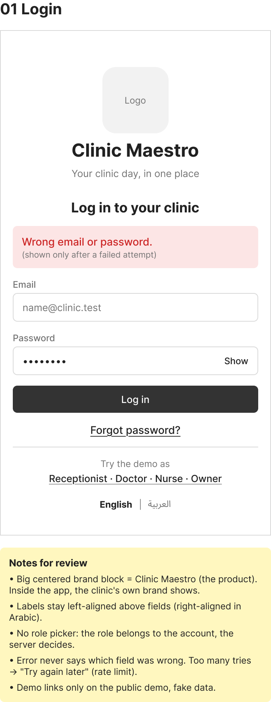                                  |
| Reception: today (phone)           | 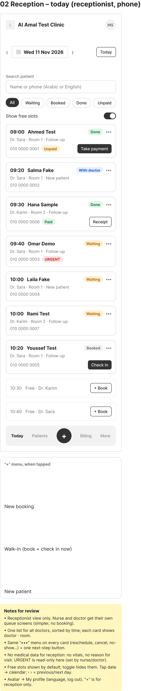                    |
| Patient profile: receptionist      | 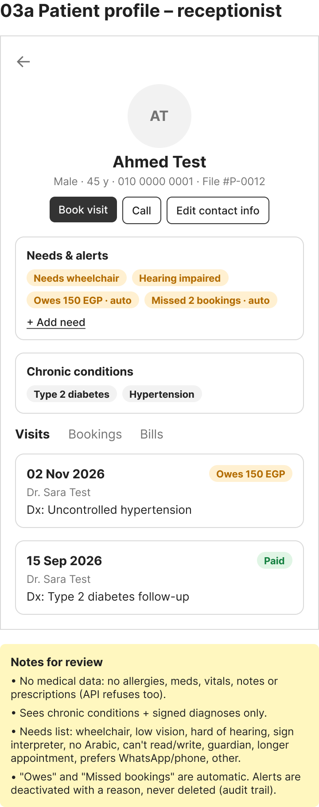  |
| Patient profile: nurse             | 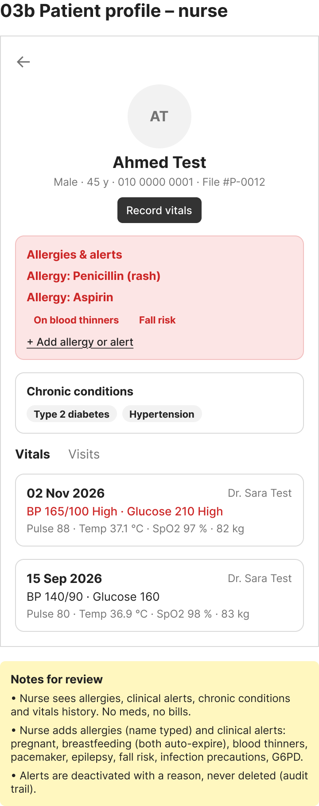                |
| Patient profile: doctor            | 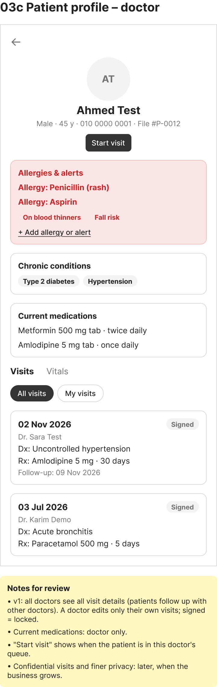              |
| Visit (doctor)                     | 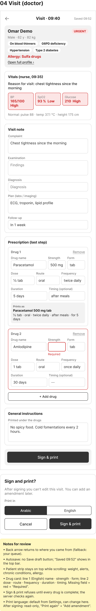                                  |
| Clinic settings (owner)            | 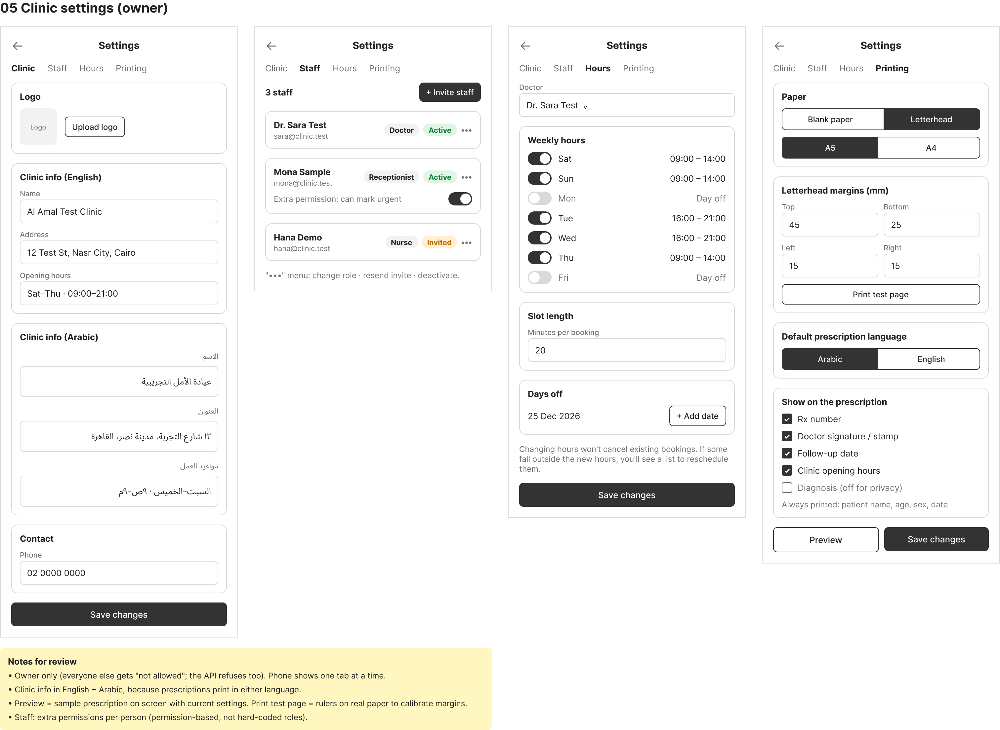                            |
| Prescription: blank paper, English | 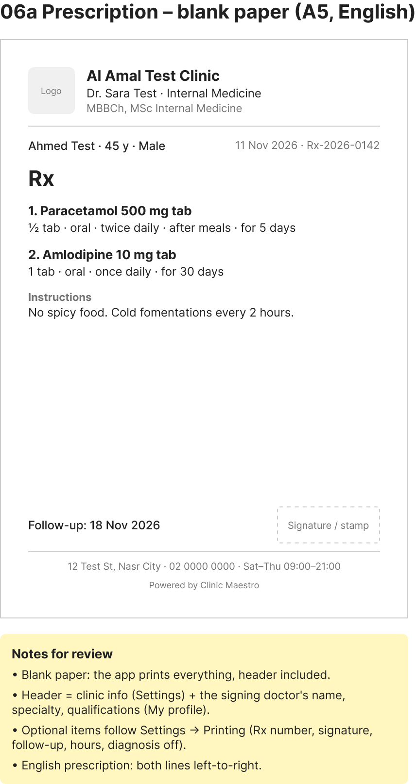                 |
| Prescription: letterhead, Arabic   | 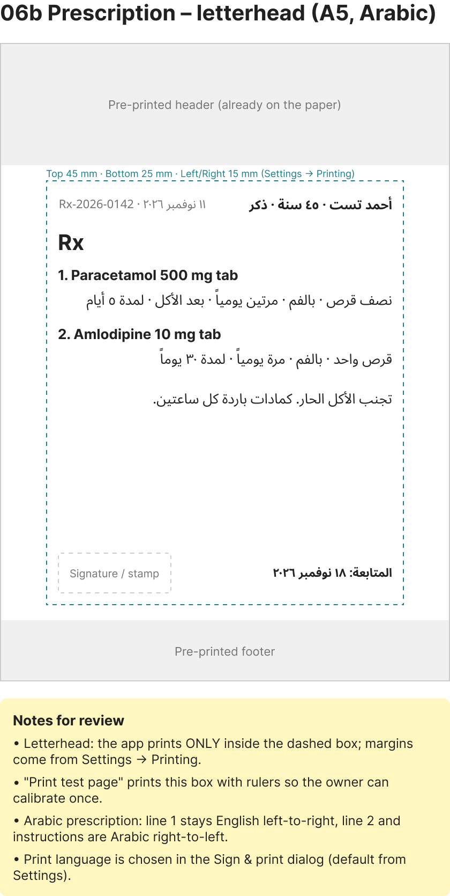 |
| Prescription: blank paper, Arabic  | 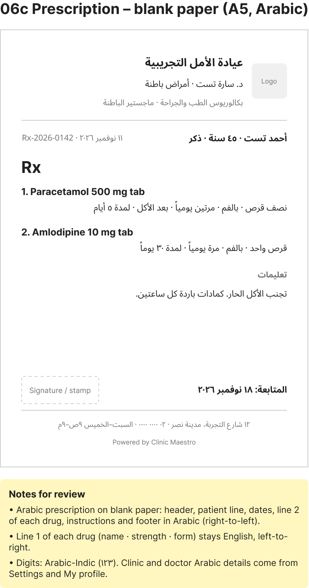                 |
| My profile                         | 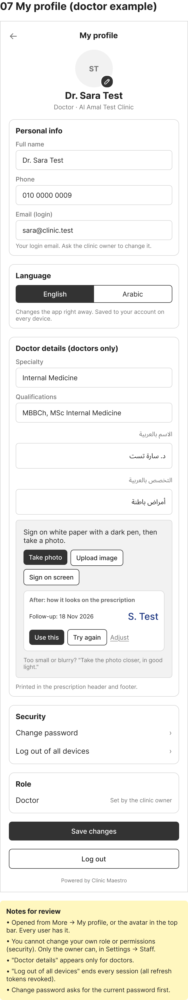                        |

Desktop layouts will be designed later (mobile first).

## Planned stack

Next.js · NestJS · PostgreSQL + Prisma · Turborepo + pnpm · free-tier hosting (Vercel, Render, Neon)

## Data

Demo data is fake. This project never uses real patient data.
